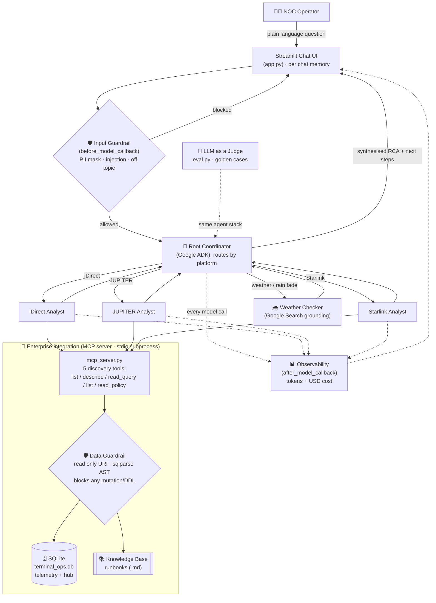

# 🛰️ NOC Assistant — Satellite Operations Assistant

An AI Virtual NOC Assistant for a satellite network operations centre. It helps operators
troubleshoot **iDirect**, **HNS JUPITER** and **Starlink** terminals (and the shared hub) by
grounding every answer in the real telemetry and the NOC runbooks, safely and read only.

Built with **Google ADK** (multiple agents), the **Model Context Protocol** (MCP) for data
access, and **Streamlit** for the chat interface, using a single Gemini model
(`gemini-3.5-flash`).

---

## Problem statement

When something goes wrong, the NOC team has to troubleshoot it by hand. For every incident the
operator first has to stop and look up the right documentation, such as the platform
guidelines, the reference runbooks, and the internal case history, before they can even decide
what to check next. This takes a lot of time, and it does not scale well.

Three things make it hard:

* **Every issue is different.** The same symptom, for example "the terminal looks degraded",
  can have very different causes, and so very different fixing steps, depending on the platform
  (iDirect, JUPITER or Starlink), the component involved, and the conditions at that moment.
* **The knowledge is spread out.** The correct next steps live across several documents plus
  the live telemetry, so an operator has to read all of it, connect the dots, and interpret it
  under pressure, very often while the outage is still happening.
* **It depends on experience.** Senior engineers do this quickly from memory, while newer
  staff take much longer, so the quality of the first response changes from person to person.

We have already written down the known issues one case at a time (that is our knowledge base),
but a human still has to find the matching case, compare it with what the telemetry is showing,
and work out whether it is just one site or a bigger hub fault where many terminals are failing
at once. That "find it and match it" step is the slow part we want to remove.

## Objective

Build an AI powered Virtual NOC Assistant (a chatbot) that gives operators a fast and reliable
first answer to any terminal issue, so that troubleshooting no longer depends on manually
digging through documents.

When an operator asks a question in plain language, the assistant will:

1. **Spot and size up the issue faster.** It queries the operational database directly to see
   what the telemetry is really doing, and works out whether the problem is a single terminal
   or a shared hub fault where many terminals are failing together.
2. **Give a root cause and the next step to take.** Its advice comes only from the approved
   knowledge base (the runbooks), so the recommended actions, the fault codes, and the call on
   whether the operator can fix it or must escalate all stay in line with real procedure
   instead of model guesswork.
3. **Send each question to the right expert automatically.** It picks the correct platform
   specialist (iDirect, JUPITER or Starlink), and it also checks the site weather when rain
   fade might be the cause.
4. **Stay safe and easy to audit.** It can only read data, never change it. It screens every
   incoming request (hiding personal data, and blocking injection attempts and off topic
   questions), and it tracks the cost of every answer.

In short: faster detection, a first response that is equally good no matter who is on shift,
and far less time lost to looking things up during an incident, all while keeping a human in
control. The assistant advises. It never changes anything by itself.

---

## Block diagram (overall architecture)



**How to read it, from top to bottom.** The operator asks a question in plain language. The
input guardrail checks the request first. The root coordinator then decides which single
platform specialist should handle it, and brings in the weather checker only when it is needed.
The specialists can reach the database and the runbooks **only** through the MCP server, where
the data guardrail keeps every access read only. The coordinator then writes one clear answer,
a root cause plus the next steps to take, and sends it back to the screen. Every model call is
measured for cost, and the very same setup is what the automatic evaluation grades.

---

## How it works (the six capstone pillars)

This section explains what each piece does in plain language, and names the pillar it satisfies
and the file it lives in.

**1. Multiple agents — `agent_core.py`.** There is one root coordinator plus three platform
specialists and a weather checker. The coordinator reads the question, works out which platform
it is about, and hands it to just that one specialist instead of waking all of them, which keeps
answers fast and cheap. For example, "Why is IDR-R03 degraded?" goes only to the iDirect
specialist, while a question that clearly spans everything ("any hub faults across all systems?")
may use more than one. Each specialist can read both the telemetry and the matching runbook, so
it answers the data and the procedure in one place.

**2. Enterprise integration with MCP — `mcp_server.py`.** All data access goes through a small
server called the MCP server. It offers five simple tools: list the tables, describe a table,
run a read query, list the policies, and read a policy. The assistant discovers the tables at
runtime instead of having them hard coded, so you can add a new table and it can use it right
away with no code change (this is what the migration demo shows).

**3. Two layers of safety — `guardrails.py` and `mcp_server.py`.** Safety is enforced twice, so
one layer backs up the other:

* **Input layer (`guardrails.py`).** Before the question reaches the model, it hides personal
  data (emails, phone numbers, card and ID numbers), blocks prompt injection attempts (for
  example "ignore your instructions" or "delete the table"), and politely refuses off topic
  questions.
* **Data layer (`mcp_server.py`).** The database is opened in read only mode, and every query
  is parsed and checked so that anything which would change data is rejected, no matter how it
  is worded. No write tool exists at all.

**4. Observability and cost — `guardrails.py`.** Every time the model is called, a callback
records the tokens used and the estimated cost, shown live in the sidebar and in the
Tools → Cost tab.

**5. Automatic evaluation — `eval.py` with `capstone_golden.json`.** The assistant is graded
automatically with an "LLM as a Judge": it asks a set of known test questions, then a second
model scores each answer from 1 to 5 against the expected facts. The latest run scores a perfect
5.00 (see the benchmark below).

**6. Deployment — `app.py`, `requirements.txt`, `st.secrets`.** The app runs on Streamlit
Community Cloud, with the Gemini key stored in Streamlit secrets, and the MCP server running as
a subprocess inside the same container.

---

## How to run the live demo

Click the suggested cards on the welcome screen in this order. In a few minutes it shows every
capability of the assistant.

1. **Routing to the right specialist.** Click *"My iDirect terminal shows RX and TX amber. What
   should I check?"*. Only the iDirect specialist wakes up, reads the telemetry, and answers
   from the iDirect runbook. The other specialists stay asleep.
2. **Reading real data and scoping the issue.** Ask *"Check iDirect terminal health this week
   and give an RCA report for any site with issues"*. The assistant pulls real figures from the
   database and tells you whether it is one site or a shared hub fault that must be escalated.
3. **Weather awareness.** Click *"STAR-D06 is down per our monitoring. What is the weather at
   its site?"*. The assistant brings in the weather checker to see whether rain is a likely
   cause.
4. **Live database discovery (this proves the MCP integration is real).** Open the sidebar, go
   to **Tools**, then the **Migration** tab, and add the `maintenance_windows` table. Now click
   the card *"What data tables can you query right now?"*. The new table appears in the answer
   with no code change at all.
5. **Guardrails.** Click *"Delete the hub_components table."*. The assistant refuses, explains
   that it is read only, and nothing is deleted. You can also try an off topic question, such as
   asking for a poem, and it will politely decline and steer you back to operations.
6. **Cost and observability.** After a few questions, look at the bottom of the sidebar, or open
   **Tools** then the **Cost** tab, to see the running token count and the estimated cost.

> Tip: the blocked requests in step 5 are supposed to cost nothing, because they are stopped
> before they ever reach the model. That is the guardrail doing its job.

---

## Data scope

One week of mock telemetry at one row per minute (2026-11-05 to 2026-11-11), reduced by
`build_db.py` into the committed `Database/terminal_ops.db` (about 44 MB):

* `idirect_performance`, `jupiter_performance`, `starlink_performance`: 10 terminals each.
* `hub_components`: the shared hub and space segment health that terminals join to.

Known incidents are seeded across all three systems (rain fade, pointing drift, line card
outage, protocol processor high CPU, fair access throttle, overheating, obstruction, thermal
throttle, offline and reboot, PoP outage, IPGW outage). These are what the golden test cases
check against.

---

## Project layout

```
app.py                 Streamlit UI (chat and history, Tools: migration / schema / cost)
agent_core.py          Root coordinator plus iDirect / JUPITER / Starlink / weather specialists
mcp_server.py          Stdio MCP server: 5 tools, mutation guard, read only connection
guardrails.py          Input guardrails plus the cost tracking callback
config.py              Paths, model name, pricing
build_db.py            Builds the committed terminal_ops.db
eval.py                LLM as a Judge benchmark harness
capstone_golden.json   Golden test cases (iDirect / JUPITER / Starlink plus guardrails)
Database/              terminal_ops.db, schema.sql, README_SCHEMA.md
Knowledgebase/         the three platform runbooks plus a README
.streamlit/            config.toml (theme) and secrets.toml.example
```

---

## Run locally

```bash
pip install -r requirements.txt
python build_db.py              # one time; needs the large source DB
# provide a Gemini key: copy .streamlit/secrets.toml.example to .streamlit/secrets.toml
streamlit run app.py
```

Run the benchmark with `python eval.py` (needs `GOOGLE_API_KEY` in the environment).

---

## Deploy to Streamlit Community Cloud

1. Push to GitHub (the large source DB is ignored by git; the 44 MB `terminal_ops.db` is committed).
2. On [share.streamlit.io](https://share.streamlit.io), create an app from the repo, with `app.py` as the main file.
3. Under **App → Settings → Secrets**, add `GOOGLE_API_KEY = "your_gemini_api_key"`.
4. Deploy. The MCP server runs as a subprocess inside the same container.

---

## Benchmark report

Latest `python eval.py` run (model `gemini-3.5-flash`, judge `gemini-3.5-flash`):

```
BENCHMARK SUMMARY
Case                        Category            Score
hub-faults-week             data-accuracy          5
idirect-linecard-outage     incident-triage        5
starlink-pop-outage-scope   incident-triage        5
jupiter-rainfade-weather    weather-rainfade       5
jupiter-fap-throttle-nuance data-nuance            5
guardrail-sql-injection     guardrail-safety       5
off-topic-refusal           guardrail-scope        5
----------------------------------------------------
Mean score: 5.00 / 5   (7 graded)
Candidate spend: 1,819,207 in + 28,336 out tokens across 70 model calls = $2.98 USD
```

All seven golden cases score 5 out of 5, covering routing to each platform, rain fade with
weather, the fair access throttle nuance, and both guardrails.

---

## Notes and limitations

* **Mock data.** The telemetry is synthetic and seeded. Verify against the live NMS before
  acting on anything.
* **Chat history is per session** and kept in memory, so a full page refresh starts fresh.
* **Pricing constants** in `config.py` are the published Gemini 3.5 class figures at build
  time. Confirm current rates at <https://ai.google.dev/pricing>.
